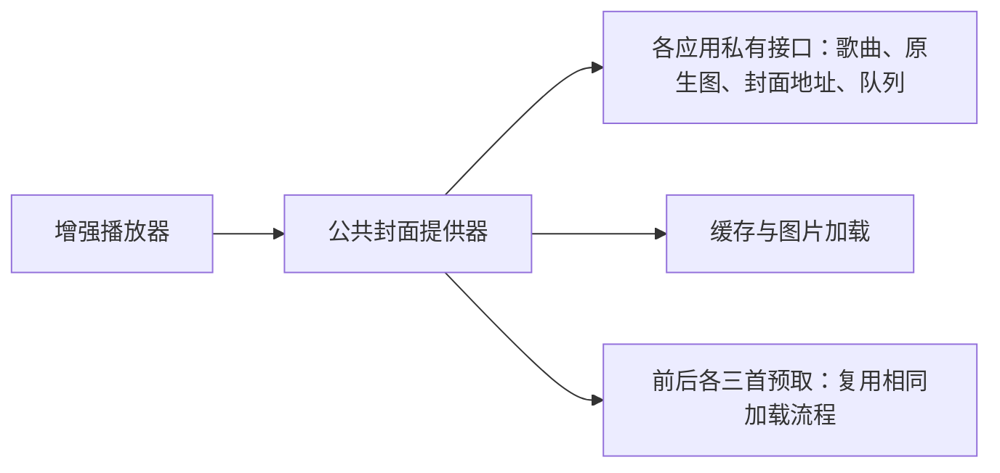

# 音乐外屏增强 · MusicEnhance

为 **Xiaomi MIX Flip / MIX Flip 2** 设计的外屏音乐增强模块，基于 **libxposed API 102**。

在外屏打开已适配音乐应用的播放页，即可使用统一的全屏播放器：专辑背景、低频律动、滚动歌词，以及避开摄像头的播放控件。各应用继续负责歌曲播放和数据提供，模块设置页采用 Miuix 风格。

[下载版本](https://github.com/daixu0502/MusicEnhance/releases) · [反馈问题](https://github.com/daixu0502/MusicEnhance/issues) · [安装与启用](#安装与启用) · [构建与签名](#构建与签名) · [自动发布](#github-actions-自动发布)

## 功能

### 外屏播放器

- **全屏专辑背景**：从屏幕中部向歌曲信息区域逐渐加深模糊，支持高清封面与缺图兜底。
- **摄像头区域布局**：黑色区域避让摄像头，控件随正反方向调整，支持整页 180° 翻转动画。
- **频谱律动**：使用独立的公共频谱模块，各应用共用多频带 spectral-flux 分析、起音门限和回落策略，在后台识别低音、鼓点及人声中高频起音；`AudioTrack` 路径按实际播放时钟驱动，各音轨独立分析，使用封面主色，暂停后平滑回落。
- **播放控制**：播放/暂停、上下首、拖动进度、循环模式和喜欢状态。循环按钮直接切换宿主支持的模式。
- **独立增强页面**：进入时从下向上滑入，退出时向下滑出，背景显示宿主首页；常规入口在原生播放页创建或展开前转入增强页，共用全屏及外屏小组件显隐策略，退出后恢复原生首页布局，返回按钮与新旧系统返回事件共用关闭流程。
- **外屏常亮**：可在设置中开启，默认关闭；仅在增强播放器前台生效，歌词页同样适用，仍可手动锁屏。
- **按应用启用**：每款音乐应用都有独立 Hook 开关，内屏保留原生界面。

### 模块主程序

主界面使用 Miuix 风格的三页底栏，各页保留各自的滚动位置：

- **信息**：模块激活状态、应用版本、LSPosed 作用域及设备和应用安装情况。
- **功能**：各音乐应用的 Hook 开关，以及播放器外屏常亮开关。
- **关于**：项目 GitHub、作者主页、问题反馈和第三方开源组件说明。

### 滚动歌词

- 点击封面页的非功能区域进入歌词页，背景切换为更深的整屏模糊。
- 歌曲信息移至返回键旁，黑色侧栏平滑延伸，显示喜欢、播放/暂停和专辑缩略图。
- 歌词跟随播放进度逐行上移，带错峰弹簧动画。
- 默认歌词为半透明灰色，当前句整句渐变为白色；距离当前句越远，上下两侧模糊越深。
- 手动滚动时平滑取消模糊，并显示选中句的开始时间；停止操作一段时间后恢复跟随。
- 点击歌词文字跳转到该句并播放；点击空白区域或专辑缩略图返回封面页。
- 没有可用的逐句歌词时显示空态。

### 封面与缓存

QQ 音乐、Apple Music、酷我、酷狗普通版、酷狗概念版和 Spotify 共用封面加载与预取流程：先显示当前歌曲可用的原生封面，后台查询缓存；没有有效缓存时，依次尝试宿主提供的高清到低清地址。当前歌曲的加载尝试结束后，按可读取的播放队列预取**前 3 首、后 3 首**，优先处理距离当前歌曲最近的条目，使用同一套清晰度降级流程。

- 当前歌曲加载与预取分别执行，重叠条目复用缓存。
- QQ 音乐的原生预览取自播放会话封面，不扫描页面中的唱片装饰或模糊背景；后台对照宿主默认封面资源过滤占位图。同曲补齐或暂缺专辑名时保留已加载封面。
- 切歌等待原生封面校验或后台缓存读取时，背景最多保留上一帧 350 毫秒，新封面就绪后立即替换；缩略图不使用上一首封面，持续缺图不会无限保留旧图。
- 歌曲到封面地址的索引随缓存保存，重开宿主可复用；图片已被清理或损坏时，从高清候选重新尝试。
- 原生图未就绪时显示空态；升级失败保留同曲原生图，不沿用上一首图片。切歌时仍需等待宿主提供与新歌曲匹配的数据。
- 异步结果校验歌曲身份，切歌或退出后作废过期请求。
- 模块提供的图片内存缓存上限为 **24 MiB**，磁盘缓存上限为 **64 MiB**；缓存保存在对应音乐应用内。
- 高清图不可用时尝试较小尺寸或原生封面；实际清晰度取决于图片来源。
- 预缓存会使用网络。随机队列、远距离跳转和快速切歌不保证命中缓存。
- 椒盐音乐直接复用原生本地封面缓存，不另行下载或重复预缓存。
- LX-X Music 仅读取宿主已加载的专辑图，不接入模块封面下载、缓存或队列预取。

## 支持范围

### 设备与环境

| 项目 | 要求 |
| --- | --- |
| 设备 | Xiaomi MIX Flip（`ruyi`）、Xiaomi MIX Flip 2（`bixi`） |
| 系统 | 小米 HyperOS，Android 14（API 34）及以上 |
| 框架 | 已安装并正常运行、支持现代 libxposed API 102 的 LSPosed 环境 |
| 使用位置 | 外屏音乐播放页 |

最低 Android 版本仅代表安装要求；外屏布局依赖小米系统实现。现有真机验证主要来自 MIX Flip 2，其他 HyperOS 版本和 MIX Flip 一代仍需结合实际设备验证。

### 音乐应用

下表为当前适配所依据的应用版本。应用更新后会尝试按特征重新定位接口；是否能恢复各项能力取决于特征与协议是否仍然有效。

| 应用 | 适配版本 | 包名 |
| --- |----------------------| --- |
| QQ 音乐 | 自动适配接口(beta) | `com.tencent.qqmusic` |
| Apple Music | 6.5.2 | `com.apple.android.music` |
| 酷我音乐 | 12.2.2.4 | `cn.kuwo.player` |
| 酷狗概念版 | 5.2.9 | `com.kugou.android.lite` |
| 酷狗音乐（普通版） | 20.8.2 / 20.8.4 | `com.kugou.android` |
| 椒盐音乐 | 12.3.2 / 12.4.1-play | `com.salt.music` |
| LX-X Music | 26.09.20（待真机验证） | `com.lxwalnut.music.mobile` |
| Spotify | 9.1.90.2270（待真机验证） | `com.spotify.music` |

### 按特征定位接口

八款应用均接入统一定位器，应用专属规则保留在各自的适配目录中。QQ 音乐所有版本统一通过业务特征定位混淆接口，不再保留版本白名单和旧混淆名快捷路径；其他应用已验证版本优先使用经过结构校验的既有协议，未知版本按特征查找候选。

| 应用 | 已加入特征定位的主要路径 |
| --- | --- |
| QQ 音乐 | 播放进程、歌曲身份、收藏管理器、循环服务、歌词点击的启动／定位／恢复播放、封面与歌手图地址、歌词加载／主歌词／时间轴／偏移、播放器入口及启动完成通知 |
| Apple Music | 原生媒体控制器、播放器底部面板、收藏操作、元数据和播放队列关联 |
| 酷我音乐 | 播放模块与歌词模块工厂、高清封面查询、原生歌词发布和逐句数据 |
| 酷狗普通版 / 概念版 | 播放入口、当前歌曲、部分循环与收藏接口、图片查询、歌词管理与解析等；两版分别定义规则 |
| 椒盐音乐 | 播放面板、媒体回调对应的控制方法、部分状态流、歌词文档和原始封面发布 |
| LX-X Music | React Native 导航、歌词模块和 TrackPlayer 元数据关联；歌曲与循环仍依赖宿主 JavaScript 协议 |
| Spotify | 媒体回调、PlayerState、收藏 PendingIntent、带原生端点注解的歌词服务及部分响应结构 |

- DEX 扫描、完整 APK 指纹计算和缓存读写在后台执行；不会通过执行候选的播放或收藏动作试探接口。
- 只有**唯一且通过校验**的候选才会启用。缺失、歧义和失败会记录对应能力；可识别的能力独立使用，无法识别的入口保留宿主原生操作。
- 缓存按宿主包名、版本、规则修订号及 base / split APK 的完整 SHA-256 失效，只保存类、方法和字段描述符，归属对应宿主进程。
- 首次扫描尚未完成时，增强入口或部分数据可能暂不可用；扫描完成后重试安装 Hook，并按实际方法去重。
- QQ 音乐在后台集中发现各项能力，嵌套依赖复用同一个 DEX 索引；缓存有效时无需重新扫描。播放、暂停、上一首、下一首和进度拖动使用系统 MediaSession；队列、收藏及调用来源保留宿主具有明确语义的协议名称，不猜测其用途。
- 自动定位不能推断已经改变的业务语义。部分歌词请求字段、队列索引、同类型状态字段和混淆操作仍只有已验证版本协议；未知版本无法证明用途时会关闭相应能力，不能保证未来更新自动恢复所有功能。
- QQ 音乐三版 APK 已使用相同的自动规则完成 25 项接口唯一性检查；这项检查不执行宿主候选动作，也不能替代播放、网络和页面生命周期的真机验证。其他应用新增扫描规则和 native 库在宿主中的加载仍待真机验证。反馈时请提供应用完整版本及日志中的 `Interface` 定位记录。
- QQ 音乐 20.9.5.8 已在 MIX Flip 2 外屏验证歌词、1500×1500 封面及六首邻近预取、收藏读写、播放／暂停、前后切歌、暂停后点歌词恢复播放、循环切换和返回重进。两版旧 QQ 仅做 APK 接口回归；本轮未验证物理折叠和内外屏切换。

## 安装与启用

1. 从 [Releases](https://github.com/daixu0502/MusicEnhance/releases) 下载并安装 APK。标记为 **Pre-release** 的版本为 Beta 测试版。
2. 在 LSPosed 中启用「音乐外屏增强」，确认模块的静态作用域已加载。
3. 打开模块设置的「功能」页，开启需要使用的音乐应用；按需开启「播放器外屏常亮」。
4. 首次启用，或更新涉及系统全屏、旋转及作用域规则时，**重启手机**。
5. 在外屏打开已启用的音乐应用，进入其播放页。

### 作用域

| 作用域 | 用途 |
| --- | --- |
| 系统框架（`system`） | 外屏全屏布局及小组件显隐策略 |
| 系统界面（`com.android.systemui`） | 外屏正反方向旋转动画 |
| 上表中的音乐应用 | 播放入口、歌曲数据与控制适配 |

无需添加外屏桌面作用域。模块采用静态作用域，应用名单由安装包提供，不能通过手动勾选给旧版本增加新适配。

仅修改应用 Hook 开关，或更新应用侧适配代码后，需要**强行停止并重新打开对应音乐应用**。模块设置页只用于配置，不提供独立播放或预览入口。

## 使用与排查

### 开启后仍是原生播放器

确认设备、框架和音乐应用版本符合支持范围，并检查模块激活状态及该应用的 Hook 开关。强行停止并重新打开音乐应用；首次启用或更新系统侧规则后需重启手机。增强界面在外屏播放页触发，音乐应用首页和内屏保持原生显示。

### 返回时闪出原生播放器、全屏或小组件异常

先安装最新版本并重新启动对应音乐应用。系统窗口策略有更新时需重启手机。反馈时请注明：点击返回按钮还是使用返回手势、进入前的屏幕方向、是否从内屏切到外屏，以及使用的音乐应用。

### 封面模糊、缺图或切歌后需要等待

高清请求不能提高源图片本身的质量。部分歌曲没有有效专辑图，QQ 音乐会尝试歌手图；其他应用按各自策略使用较小尺寸或原生图片。预缓存只覆盖邻近队列，首次加载、缓存被清理或网络较慢时仍可能等待。

### 歌词为空，或喜欢按钮暂时不可用

歌词依赖宿主提供的逐句时间轴；只有纯文本歌词或原生没有歌词时，无法自动滚动。喜欢操作依赖宿主返回当前歌曲状态，并保留宿主的登录和收藏限制。椒盐和 LX-X 的喜欢图标仅作固定显示，酷狗概念版 AI 歌曲暂不支持收藏适配。

### 无法覆盖安装

新旧 APK 必须使用相同签名证书。Debug 包、自行签名包与已安装的发布包可能使用不同证书；需要更换签名时，先记录模块配置，再卸载旧模块、安装并重新启用。

### 提交反馈

请在 [Issues](https://github.com/daixu0502/MusicEnhance/issues) 中提供：

- 设备型号、Android / HyperOS 版本。
- 模块版本、音乐应用名称与完整版本号。
- 复现步骤、预期结果和实际结果。
- 与问题相关的截图或录像；旋转问题注明正反方向及内外屏切换过程。
- 复现后的 LSPosed 日志，模块日志标签为 `MusicEnhance`。
- 封面或歌词问题对应的歌曲名、歌手和具体录音版本。

分享日志前请检查其中是否包含个人信息。

## 构建与签名

### 构建环境

- **JDK 17**。
- **Android SDK Platform 37.0**，SDK 包名为 `platforms;android-37.0`。
- 项目自带的 Gradle Wrapper；首次构建需要联网下载依赖。

在 Android Studio 中配置 SDK，或在本地 `local.properties` 设置 `sdk.dir`。构建参数以 [app/build.gradle.kts](app/build.gradle.kts) 和 [依赖版本目录](gradle/libs.versions.toml) 为准。

在项目根目录运行，以下为 Windows PowerShell 命令；macOS / Linux 将 `.\gradlew.bat` 替换为 `./gradlew`：

```powershell
# Debug 包
.\gradlew.bat :app:assembleDebug

# 单元测试、Release 静态检查和 Release 构建
.\gradlew.bat --no-configuration-cache :app:testDebugUnitTest :app:lintRelease :app:assembleRelease
```

测试任务只会执行当前检出中存在的测试。若没有 `app/src/test` 源码，`testDebugUnitTest` 可能显示 `NO-SOURCE`，不代表行为已通过验证。外屏方向、系统窗口和宿主私有接口仍需真机检查。

### Release 签名

构建前通过本机环境变量提供签名配置：

| 环境变量 | 内容 |
| --- | --- |
| `MUSICENHANCE_KEYSTORE` | 签名库文件路径 |
| `MUSICENHANCE_STORE_PASSWORD` | 签名库密码 |
| `MUSICENHANCE_KEY_ALIAS` | 密钥别名 |
| `MUSICENHANCE_KEY_PASSWORD` | 密钥密码；未设置时使用签名库密码 |

配置完成后运行 `:app:assembleRelease`。证书、密码及个人路径不要提交到仓库。

| 构建方式 | 默认产物位置 |
| --- | --- |
| Gradle Debug | `app/build/outputs/apk/debug/app-debug.apk` |
| Gradle Release，未配置签名 | `app/build/outputs/apk/release/app-release-unsigned.apk` |
| Gradle Release，已配置签名 | `app/build/outputs/apk/release/app-release.apk` |
| Android Studio 签名向导 | 由向导中的目标目录决定，可能为 `app/release` |

Release 已启用 **R8 代码压缩、混淆和资源优化**，无需额外开启体积优化开关。

## GitHub Actions 自动发布

[发布工作流](.github/workflows/release.yml) 会从 Gradle 读取版本和 SDK 配置，完成构建、签名校验、变更说明生成及附件上传。

### 仓库配置

在仓库 **Settings → Secrets and variables → Actions** 中添加：

| Repository secret | 内容 |
| --- | --- |
| `MUSICENHANCE_KEYSTORE_BASE64` | 签名库文件的 Base64 编码内容 |
| `MUSICENHANCE_KEY_ALIAS` | 密钥别名 |
| `MUSICENHANCE_STORE_PASSWORD` | 签名库密码 |
| `MUSICENHANCE_KEY_PASSWORD` | 可选；与签名库密码相同时可以不设置 |

工作流使用 `GITHUB_TOKEN` 发布，需要仓库允许 Actions 获得 `contents: write` 权限。没有完整签名配置时，发布构建会失败。

### 触发与版本规则

推送到 `main`、推送 `v*` 标签，或在 Actions 页面手动运行 **Build and publish release**，均会触发工作流。

发布前在 `app/build.gradle.kts` 中更新 `versionName`，并递增 `versionCode`：

| `versionName` 示例 | 标签 | 发布类型 |
| --- | --- | --- |
| `2.6.1` | `v2.6.1` | Release 正式版 |
| `2.7.0-beta1` | `v2.7.0-beta1` | Pre-release 测试版 |
| `2.7.0-beta.2` | `v2.7.0-beta.2` | Pre-release 测试版 |

- 支持两段或三段数字版本，以及 `-beta`、`-beta1`、`-beta.1` 等后缀；其他后缀目前不支持。
- 标签触发时，标签必须与 `v` 加 `versionName` 完全一致。
- 该版本已公开发布时会跳过构建和上传，不覆盖已有附件和说明；推送新代码但不改版本号，不会更新已发布的包。
- 正式版与上一个已发布正式版比较，Beta 与上一个已发布 Pre-release 比较；基准按发布时间选择。
- Release Notes 使用这段范围内的**非合并提交标题**生成，并附完整对比链接；首个同类版本汇总截至该版本的提交。
- 上传 `MusicEnhance-v<版本>.apk` 和 SHA-256 校验文件；附件全部上传后才公开发布。上传失败时可能留下可重试的草稿。

具体发布规则见 [release.py](.github/scripts/release.py)。

## 开发与扩展

开发约定见 [AGENTS.md](AGENTS.md)。应用私有接口集中在适配层，通用播放器负责展示、交互和生命周期。

### 数据与操作边界

每款应用通过 `<应用>PlayerAdapter.createSession()` 组装 `PlayerSession`：

| 接口或组件 | 职责 |
| --- | --- |
| `PlayerDataSource` | 歌曲快照、播放及控制状态、原生封面和低频数据 |
| `LyricsProvider` | 当前歌曲的逐句歌词与加载状态 |
| `ArtworkProvider` | 封面获取、歌曲校验、缓存及预取 |
| `PlayerActions` | 播放、切歌、定位、循环与喜欢等操作回调 |
| `PlayerController` / `PlayerDisplayState` | 汇总数据，并向界面提供统一显示状态 |
| `EnhancedPlayerActivity` | 承载增强界面，管理方向、返回与资源释放 |

`createSession(activity)` 接收增强 Activity，数据与控制不再读取原生播放器 View。QQ、酷狗及酷狗概念版的喜欢操作直接使用宿主收藏管理器或业务委托；需要登录等上下文时使用存活的首页 Activity。

常规导航直接进入增强页，底层保留宿主首页。进出场使用属性位移动画；启用透明窗口前先收起恢复路径中已存在的原生页。内屏已经打开的播放页、系统恢复或未经过应用启动 Hook 的入口仍走恢复路径；启动失败回退到原生导航，并避免重复拦截。

本轮透明窗口及酷狗 20.8.4 接口已做静态核对和自动化测试，尚待真机验证动画、折叠切换及收藏操作。

椒盐 12.4.1-play 已按新版 APK 更新播放页入口、控制、原生封面和歌词接口，并保留 12.3.2 协议。酷我进出场动画的就绪判断已排除残留的内屏尺寸；这两项修复尚待真机验证。

增强页面正式结束时即释放启动去重状态，首页恢复后可以立即再次进入；会话和提供器仍按 Activity 生命周期释放。取消返回、退出被拒绝或页面重建时继续保留当前路由，旧页面销毁不会清除新页面的启动状态。

QQ 音乐 20.8.5.8 / 20.9.0.8 的播放器入口还持有宿主启动锁，原本由原生页恢复显示时释放。增强页成功恢复显示后调用同一完成通知，避免退出后必须等待约 5 秒才能再次进入；此项已核对两版 APK，待真机复测。

UI 不直接读取宿主类名、反射字段或网络接口。各适配器创建并管理自己的提供器，可复用通用缓存实现，数据保存在各自宿主中。椒盐复用原生缓存，LX-X 仅接收宿主已加载图片，其他应用按私有封面来源接入模块的封面提供器。

五款联网播放器通过 `PlaylistArtworkSource` 提供歌曲身份、按质量排序的候选地址和相邻播放队列，并注入原生封面的读取回调。`PlaylistArtworkProvider` 统一负责原生图优先显示、缓存查询、下载降级、结果校验和队列预取；`ArtworkLoader` 与 `ArtworkDiskCache` 分别负责图片加载和磁盘存储。控制器直接接收提供器的选图结果，避免再次选回旧封面。



LX-X 的 `app/src/main/resources/lxx/state-bridge.js` 是 React Native 适配脚本：监听歌曲与设置事件，经已有原生桥传递歌曲 ID、歌词和播放模式；仅观察宿主已执行的模块导出，循环操作调用宿主设置更新入口。增强界面仍由 Kotlin 实现；脚本不修改宿主 APK，也不请求封面或歌词接口。

### 目录

| 位置 | 内容 |
| --- | --- |
| [adapter](app/src/main/java/com/jaco/musicenhance/adapter) | 应用注册及 `qq`、`apple`、`kuwo`、`kugou`、`kugoulite`、`salt`、`lxx` 适配 |
| [player](app/src/main/java/com/jaco/musicenhance/player) | 通用 Activity、会话、控制器和数据接口 |
| [player/ui](app/src/main/java/com/jaco/musicenhance/player/ui) | 播放器、歌词与控件展示 |
| [player/lyrics](app/src/main/java/com/jaco/musicenhance/player/lyrics) | 歌词提供器与交互逻辑 |
| [player/artwork](app/src/main/java/com/jaco/musicenhance/player/artwork) | 封面下载、缓存、预取及过渡 |
| [player/audio](app/src/main/java/com/jaco/musicenhance/player/audio) | 公共音频采样、频谱分析及播放时间轴；不依赖音乐应用的私有接口 |
| [device](app/src/main/java/com/jaco/musicenhance/device) | 外屏识别、摄像头定位和布局 |
| [hook](app/src/main/java/com/jaco/musicenhance/hook) | 模块入口、宿主 Hook、Activity 路由及系统窗口策略 |
| [.github](.github) | 自动构建与发布脚本 |

接入新播放器时：

1. 添加 `<应用>PlayerProfile` 和 `<应用>PlayerAdapter`，通过现有注册机制接入。
2. 在应用适配目录实现播放入口、原生页面退出、歌曲状态、歌词、封面与控制接口。
3. 通过 `createSession()` 注入数据和操作；缺失能力返回未知或不支持。
4. 更新静态作用域及 Manifest 查询配置。
5. 验证冷启动、快速切歌、暂停后歌词定位、返回、正反旋转、内外屏切换及小组件恢复。

耗时工作放到后台，异步结果校验歌曲身份；动画、监听、任务和提供器须有对应的取消或释放路径。仅添加包名和作用域不代表完成适配。
